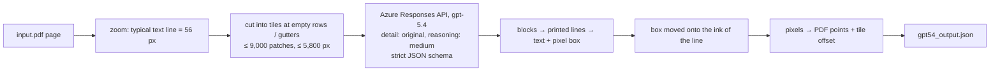

# GPT-5.4 as OCR for marketing assets: POC report

**Question:** can Azure GPT-5.4 (a vision model) replace Mistral / LlamaParse / LandingAI for asset text extraction
**and** positions (boxes), on the hardest assets we have (picture-only pages, very long pages, social-media
storyboards)?

**Short answer:** on these 13 assets GPT-5.4 is the best single extractor. It has the highest word accuracy and the
highest block-box accuracy, and is close behind LandingAI on line boxes. It is **not at 100%**: 75% of its blocks
are fully right (text and box), against 46% for LandingAI and 56% for LlamaParse on the same 10 assets. Where it loses,
it loses on boxes for dense UI mock-ups and storyboards, not on reading.

## 1. Results

Scores against the reference described in §3. "Words found" = share of the reference words the extractor
returned (completeness). "Words correct" = share of the extractor's words that are on the page (no misreads,
inventions or junk). "Block boxes OK" = share of blocks whose box holds its own words and no one else's.
"Blocks fully OK" = text and box both right.

### 1.1 Overall

Only the 10 assets all four extractors ran on (LandingAI had no run for 08, 10 and 11, see §5):

| Extractor | Words found % | Words correct % | Block boxes OK % | Blocks fully OK % | Line boxes OK % |
|---|---|---|---|---|---|
| **GPT-5.4** | **97.9** | **96.4** | **89.4** | **75.0** | 88.1 |
| LandingAI | 96.9 | 94.8 | 76.3 | 46.1 | 93.7 |
| LlamaParse agentic_plus, plain (§9) | 93.8 | 89.9 | 75.4 | 53.9 | **97.9** of the lines it boxed; 21.6% of its blocks have no box |
| LlamaParse agentic (OCRia-1), plain (§9) | 87.9 | 92.0 | 74.2 | 50.3 | 97.8 of the lines it boxed; 18.2% of its blocks have no box |
| LlamaParse agentic_plus, app pipeline (first run) | 89.7 | 91.7 | 75.9 | 56.3 | – (not scored) |
| Mistral | 23.9 | 25.8 | 82.7 | 13.5 | – (no line boxes) |

All 13 assets (each extractor on what it ran): GPT-5.4 95.9 / 94.3 / 87.9 / 68.6 / 87.1; Mistral 29.0 / 32.4 / 85.0 / 18.4;
LlamaParse 87.9 / 90.9 / 78.5 / 58.0.

### 1.2 Per asset

| Asset | Extractor | Words found % | Words correct % | Block boxes OK % | Blocks fully OK % | Line boxes OK % |
|---|---|---|---|---|---|---|
| 01 BREZTRI (picture pages) | gpt54 | 99.7 | 99.7 | 89.9 | 88.0 | 88.6 |
| | mistral | 5.6 | 3.4 | 80.9 | 1.1 | – |
| | llamaparse | 78.3 | 88.2 | 60.5 | 48.9 | – |
| | landingai | 98.9 | 97.0 | 56.5 | 38.9 | 95.4 |
| 02 JARDIANCE (p2 = 19:1 picture) | gpt54 | 99.6 | 99.3 | 92.8 | 88.7 | 95.6 |
| | mistral | 1.0 | 16.7 | 0.0 | 0.0 | – |
| | llamaparse | 92.0 | 86.2 | 43.9 | 40.0 | – |
| | landingai | 91.2 | 98.5 | 71.4 | 35.7 | 48.4 |
| 03 JASCAYD (picture) | gpt54 | 100.0 | 100.0 | 98.3 | 98.3 | 96.4 |
| | mistral | 9.0 | 49.7 | 0.0 | 0.0 | – |
| | llamaparse | 98.9 | 88.7 | 95.2 | 78.7 | – |
| | landingai | 98.6 | 98.6 | 90.9 | 72.7 | 100.0 |
| 04 ULTOMIRIS TV Spot | gpt54 | 99.1 | 99.2 | 86.1 | 75.0 | 78.6 |
| | mistral | 0.6 | 2.7 | 88.9 | 0.0 | – |
| | llamaparse | 82.3 | 97.1 | 12.4 | 11.2 | – |
| | landingai | 98.9 | 97.7 | 83.1 | 69.5 | 97.1 |
| 05 LIVDELZI 0460 ⚠ | gpt54 | 93.4 | 85.6 | 92.8 | 49.0 | 97.3 |
| | mistral | 13.0 | 25.0 | 61.0 | 9.8 | – |
| | llamaparse | 89.3 | 86.0 | 91.1 | 46.4 | – |
| | landingai | 92.7 | 83.5 | 70.5 | 27.9 | 98.2 |
| 06 LIVDELZI 0449 | gpt54 | 96.5 | 89.7 | 67.1 | 49.7 | 56.5 |
| | mistral | 32.7 | 12.6 | 90.1 | 14.7 | – |
| | llamaparse | 97.5 | 88.0 | 84.9 | 47.5 | – |
| | landingai | 98.2 | 91.2 | 79.6 | 44.6 | 98.4 |
| 07 ULTOMIRIS RTE Patient Case | gpt54 | 100.0 | 98.6 | 100.0 | 93.2 | 99.2 |
| | mistral | 3.9 | 16.4 | 34.0 | 0.0 | – |
| | llamaparse | 99.3 | 99.1 | 97.8 | 83.1 | – |
| | landingai | 99.7 | 97.0 | 77.8 | 65.8 | 99.7 |
| 08 IMDELLTRA ⚠ | gpt54 | 90.6 | 89.4 | 71.2 | 43.7 | 59.0 |
| | mistral | 74.0 | 97.4 | 98.2 | 76.5 | – |
| | llamaparse | 95.7 | 90.4 | 77.8 | 47.2 | – |
| | landingai | no run | | | | |
| 09 LIVDELZI 0495 | gpt54 | 94.0 | 95.6 | 98.7 | 71.6 | 99.4 |
| | mistral | 50.4 | 80.7 | 94.5 | 70.7 | – |
| | llamaparse | 92.7 | 98.0 | 92.0 | 73.7 | – |
| | landingai | 94.1 | 98.0 | 81.2 | 65.6 | 99.7 |
| 10 LIVDELZI 0532 | gpt54 | 83.8 | 95.2 | 85.5 | 60.4 | 92.0 |
| | mistral | 26.8 | 58.3 | 82.2 | 29.2 | – |
| | llamaparse | 68.9 | 97.8 | 89.7 | 75.8 | – |
| | landingai | no run | | | | |
| 11 LIVDELZI 0519 ⚠ | gpt54 | 99.4 | 63.1 | 96.3 | 44.8 | 97.5 |
| | mistral | 80.5 | 39.2 | 96.8 | 52.0 | – |
| | llamaparse | 97.7 | 65.1 | 92.7 | 60.6 | – |
| | landingai | no run | | | | |
| 12 TRODELVY 17618 ⚠ | gpt54 | 91.0 | 92.6 | 75.0 | 58.8 | 60.3 |
| | mistral | 12.8 | 42.7 | 61.2 | 33.1 | – |
| | llamaparse | 92.4 | 92.0 | 81.3 | 64.0 | – |
| | landingai | 93.4 | 88.7 | 69.7 | 28.6 | 91.8 |
| 13 TRODELVY 17749 ⚠ | gpt54 | 99.3 | 96.2 | 92.3 | 64.4 | 96.7 |
| | mistral | 87.8 | 96.7 | 100.0 | 71.2 | – |
| | llamaparse | 98.0 | 96.2 | 90.6 | 64.3 | – |
| | landingai | 97.9 | 95.3 | 95.2 | 47.6 | 99.7 |

⚠ = reference partly unchecked (the PDF's own machine-OCR layer, see §3.2). On those assets **every** extractor's
"words correct" is understated by the same reference errors (11: the layer misses most picture text, so all three
score 39–65%). Compare extractors on these rows, not the absolute value.

The visual result for every cell is `assets/<asset>/<extractor>_annotated.pdf`: green box = block right, red box +
red note = wrong box and / or misread / skipped words, red fill "MISSING" = reference words nobody returned in place.

## 2. How GPT-5.4 is used



* **One call per tile, in parallel (8).** The prompt asks for every printed line, verbatim, grouped into
  blocks (heading, paragraph, list item, button, …), in reading order, with a tight box in the tile's pixel space.
  Output is a strict JSON schema (`vlm_extract.SCHEMA`): no free text, no parsing.
* **`detail: "original"`** is what makes it work: on Azure gpt-5.4 `high` / default shrinks the image to a 768 px
  short side (§4), `original` sends up to 10,000 patches unscaled.
* **Rendered size matters more than anything else** (asset 07, 8,096 pt tall page, same prompt):

| Text-line height in the image | Tile size | Words found | Words correct | Block boxes | Line boxes | Calls | Input tokens |
|---|---|---|---|---|---|---|---|
| 26 px | 2,048 | 99.2 | 98.2 | 84.8 | 69.9 | 12 | 29 k |
| 26 px | 1,024 | 99.5 | 97.5 | 94.6 | 86.8 | 37 | 42 k |
| 40 px | 2,048 | 99.8 | 98.3 | 98.9 | 97.1 | 28 | 70 k |
| 40 px | 1,536 | 99.5 | 97.8 | 100 | 98.5 | 37 | 75 k |
| 56 px | 2,048 (cut at gutters) | **100** | **98.6** | **100** | **99.2** | 44 | 132 k |

  Reading is good even at small size; **positions** need large text. The model's coordinates are good to roughly
  a fraction of a text line, so the bigger the line in pixels, the smaller the error in points.
* **Tiles are cut only where the page is empty** (rows: emptiest row near the tile edge; columns: only in empty
  gutters, a tile may grow to 5,800 px to reach one). A first version cut columns anywhere and produced word
  fragments ("budeson", "oduce") on BREZTRI; gutter-only cuts fixed it (BREZTRI words correct 96.3% → 99.7%).
* **Snap to ink:** each line box is moved onto the printed pixels of that line (top / bottom to the ink rows,
  left / right to the ink extent). +3 points on line boxes at 26 px; kept on.

Cost on the 13 assets: **731 calls, 2.28 M input + 1.23 M output tokens, ~45 min** wall time when run one asset at a
time (8 calls in parallel per asset). The biggest asset (10, 5 storyboard pages ~4,000 pt wide) took 202 calls.

## 3. How accuracy is measured (same method for all four)

### 3.1 Matching

Words are compared after normalisation: NFKC, lower case, letters / digits runs (+ `%`), `®™©` and HTML / markdown
syntax dropped, a hyphen inside a word or at a line end removed. **Not scored:** case, punctuation, spacing.

1. **Local:** each block's words are aligned with the reference words whose centre is inside the block's box
   (smallest boxes first; a reference word is used once).
2. **Global:** leftover words are matched anywhere on the page in runs of ≥ 3 identical words: right text, wrong box.
3. **Box OK** = ≥ 95% of the block's found words inside its box, ≤ 5% foreign reference words inside it, top and bottom
   within max(8 pt, 1.5 lines) of its words. Left / right edges are not measured (OCR-layer word widths are
   approximate, §3.2).

The same rule is applied with each **line** as the unit for line boxes (GPT-5.4 and LandingAI return lines).

### 3.2 The reference (ground truth)

| Source | Where | Trust |
|---|---|---|
| Visible PDF text layer | 07, 09, 10, most of 02 p1, 04 and 01 p9–10 | exact characters and positions |
| **Judge transcription** of picture text (Claude, line by line from crops; line boxes from ink rows of the page pixels, or measured on a ruler render for text on photos) | 01 p1–8 (10,749 words), 02 p2 (2,032), 03 (836), 04 picture text (2,558) | checked line by line |
| PDF's invisible OCR layer, lines rebuilt from ink rows, **disputed lines checked and corrected by the judge** | 06 | checked where ≥ 2 extractors disagree with it (2 rounds, 187 lines answered: e.g. the layer drops "LIVDELZI" in most lines; link-annotation labels it holds are not printed) |
| PDF's invisible OCR layer, **unchecked** | 05, 08, 11, 12, 13, 156 words on 02 p1 | machine OCR, known to drop words (⚠ rows) |

Picture text on 09 / 10 (social canvases with photos) was not transcribed: text baked into those photos is not in the
reference, so an extractor that reads it is counted as "not on the page". The judge work was stopped before §3.2's
unchecked rows were done (user decision, to save effort).

## 4. Azure `detail` findings (separate note)

Measured on this deployment (`usage.input_tokens`, see
[../Azure_openai_new_image_patch_logic.md](../Azure_openai_new_image_patch_logic.md)):

| detail | what the model gets | max tokens / image |
|---|---|---|
| none / `auto` / `high` | short side scaled to **768 px** (long side ≤ 2,048) | ~1,850 |
| `original` | unscaled up to 10,000 32-px patches, long side ≤ 6,000 px | 12,000 |
| `low` | 512 × 512 | ~310 |

Legibility test (60 eight-digit numbers at 11 px, 1,600 × 1,600 image): `high` 57 / 60 exact, `original` 60 / 60.
`label/utils/page_images.py` is outdated: it sends no `detail` and sizes images for 2,500 patches, which Azure then
shrinks to a 768 px short side.

## 5. Provider runs

| Provider | Runs | Notes |
|---|---|---|
| Mistral (`mistral-ocr-4-0`, Azure) | fresh, all 13 | Called directly, **without** the app's routing (the app sends long / picture pages to LlamaParse first). On tall pages it reads a ~1,000 px render (07: dpi 9) and invents text ("THE WALL STREET JOURNAL" × n, Chinese company minutes, "Navier g4t1-ethanes"). Good where pages are normal size (08, 13). |
| LlamaParse (agentic_plus), first run | fresh, all 13 | Through the app's entry point: `parse_options` = version `latest`, `output_options.granular_bboxes: ["line"]`, `processing_options.ignore.ignore_diagonal_text: true`, no custom prompt; then the app's conversion (diagram / repeat / missing-text logic) and `finalize_asset_ocr`, which **invents a box** (text layer or estimated band) for every item LlamaParse left without one. Line boxes were not scored. Weakest boxes on picture pages (02 p2: 44% block boxes; 04: 12%). Re-run without the app layer in §9. |
| LandingAI DPT-3 Pro (+ LlamaParse figure job) | fresh 01–07; app's stored run (21 Oct) for 09, 12, 13; **none** for 08, 10, 11 | Credit quota exhausted mid-run (HTTP 402 "Credit quota exceeded"). Best line boxes overall; its blocks are often whole columns (block fully OK 46%). Line boxes drift on the 19:1 page (02 p2: 48%). |

## 6. What GPT-5.4 still gets wrong

* **Boxes on dense UI mock-ups / storyboards** (06 0449 line boxes 56%, 08 59%, 12 60%): many small, close
  lines inside phone / desktop mock-ups. Its text there is right; boxes slide to neighbouring lines.
  LandingAI is better here (98%).
* **Tiny print** (2–3 pt mobile previews in 06 / 05): sometimes merged into one block across columns.
* **Very wide canvases** (10, ~4,000 pt): 84% of words found; some frames' small print skipped.
* Not checked: whether any of its "words correct" losses are invented text. On ⚠ rows most of them are reference
  gaps (all extractors lose the same words); the red notes in `gpt54_annotated.pdf` list each one.

## 7. Recommendation

1. GPT-5.4 with `detail: "original"`, text lines rendered at ~56 px and gutter tiling is a viable **single** OCR for
   picture pages and long pages, where all three providers fail on boxes, text or both (01–04, 07).
2. For line-level boxes on dense mock-ups, either keep LandingAI's line boxes or add a second GPT pass per block
   crop (not tested).
3. Fix `page_images.py` (§4) independently of this POC.
4. Before any decision on ⚠ assets, finish the judge check of their OCR layers (`judge.py rebuild-ocr` +
   `disputes`, as done for 06).

## 8. How the boxes come out of GPT-5.4

### In plain words

GPT-5.4 has no "give me bounding boxes" switch (unlike LandingAI or LlamaParse). We **ask** for them, like any
other answer:

1. We show the model a picture (a tile of the page) and tell it the picture's size: "Image size: 2496 x 1703 pixels".
2. We tell it: for every printed line, write the text, and write where the line is as four numbers, the left, top,
   right and bottom pixel of that line in this picture (pixel 0,0 = top-left corner).
3. A strict JSON schema makes the reply always have that shape. The model cannot skip a box or answer in prose.
4. The model looks at the picture and writes those numbers, the same way it would answer "where is the cat?".
   They are its estimate, usually off by a few pixels.
5. Our code then (a) nudges each box onto the actual printed pixels nearby ("snap to ink"), and (b) converts the
   tile's pixels back to PDF points, because the tile is a zoomed piece of the page.

### A real example (asset 07, page 1, tile 12)

| Step | Value |
|---|---|
| The tile | the page area x 0 – 946 pt, y 3,149 – 3,794 pt, rendered at zoom 2.638 → a 2,496 × 1,703 px image |
| GPT-5.4's answer for one line | text `Prescribing ULTOMIRIS may give Madison the opportunity to improve her`, box `x0 306, y0 198, x1 1698, y1 240` (pixels in that image) |
| Snap to ink | the line's dark pixels actually span `309, 197, 1664, 239` (the model's right edge was 34 px too long) |
| To PDF points | x = 0 + 309 / 2.638 = 117.1; y = 3,149.3 + 197 / 2.638 = 3,224.0; → box **117.1, 3,224.0, 630.7, 3,239.9** |
| Truth (the PDF's own text layer for that line) | 116.0, 3,218.4, 630.3, 3,239.7 (its top is higher because a font box includes room above the letters) |
| Block box | the paragraph's 10 line boxes joined into one box: the model is never asked for block boxes |

Why the zoom matters (§2): if a text line is only 26 px tall in the picture, the model's "few pixels off" is a large
share of the line and boxes land on the neighbouring line. At 56 px the same error is small.

### The flow

Everything after the reply is our code (`vlm_extract.py`: `extract` → `assemble` → `snap_line`).

```mermaid
sequenceDiagram
  participant P as PDF page (points)
  participant C as vlm_extract.py
  participant G as Azure gpt-5.4
  C->>P: zoom z so a text line is ~56 px; cut tiles at empty rows / gutters
  P-->>C: tile rect in points (x_t, y_t, ...) + PNG rendered at zoom z (W x H px)
  C->>G: instructions (system prompt) + "Image size: W x H pixels. This image is tile i of n."<br/>+ input_image (detail: original) + json_schema (strict)
  G-->>C: {"blocks":[{"type", "lines":[{"text", "box":{x0,y0,x1,y1}}]}]}  (tile pixels, top-left origin)
  C->>C: snap each line box onto the printed ink of the tile (rows / columns of non-background pixels)
  C->>C: points = tile offset + pixels / z  → x = x_t + x_px / z, y = y_t + y_px / z, clipped to the tile
  C->>C: block box = union of its line boxes
  C-->>P: gpt54_output.json (blocks + lines, PDF points, top-left origin)
```

| Step | Space | Code |
|---|---|---|
| Model reply | pixels of the tile image, origin top-left, integers | `SCHEMA` → `line.box` |
| Snap to ink | same pixels; top / bottom moved to the ink rows around the box middle, left / right to the ink extent (gaps narrower than a line height bridged) | `snap_line` |
| To the page | PDF points: `x_t + x_px / zoom`, `y_t + y_px / zoom` | `assemble` |
| Block box | union of the block's line boxes (never asked from the model) | `assemble` |

Why per line and not per block: a line box is short and one text-line high, so the model's coordinate error is
small, and the block box follows from its lines. (Asking the model for block boxes directly was not tested.)

### 8.1 Structured output schema (strict, as sent)

Sent as `text={"format": {"type": "json_schema", "name": "page_text", "strict": True, "schema": SCHEMA}}` on
`client.responses.create(model="gpt-5.4", reasoning={"effort": "medium"}, ...)`.

```json
{
  "type": "object",
  "additionalProperties": false,
  "required": ["blocks"],
  "properties": {
    "blocks": {
      "type": "array",
      "items": {
        "type": "object",
        "additionalProperties": false,
        "required": ["type", "lines"],
        "properties": {
          "type": {
            "type": "string",
            "enum": ["heading", "paragraph", "list_item", "table_cell", "caption",
                     "footnote", "button", "logo_text", "chart_text", "other"]
          },
          "lines": {
            "type": "array",
            "items": {
              "type": "object",
              "additionalProperties": false,
              "required": ["text", "box"],
              "properties": {
                "text": {"type": "string"},
                "box": {
                  "type": "object",
                  "additionalProperties": false,
                  "required": ["x0", "y0", "x1", "y1"],
                  "properties": {
                    "x0": {"type": "integer"},
                    "y0": {"type": "integer"},
                    "x1": {"type": "integer"},
                    "y1": {"type": "integer"}
                  }
                }
              }
            }
          }
        }
      }
    }
  }
}
```

The box is an object with four named integers, not an array: strict mode then guarantees exactly four values with
known meaning.

### 8.2 Prompt (instructions)

```text
You are a precise OCR engine for pharmaceutical marketing material.
Transcribe EVERY piece of printed text visible in the image, including text inside pictures, charts, buttons,
logos with words, footnotes and tiny legal print. Do not describe images, do not summarise, do not correct
spelling, do not translate, do not invent text that is not printed.

Output blocks in natural reading order. A block is one visually separate unit: a heading, a paragraph, one list
item, one table cell, one button, one caption, one footnote. Never merge separate paragraphs or a heading with
its paragraph into one block. Text repeated at several places (for example the same safety text in several
frames) is a separate block at each place.

Each block is a list of its printed lines, top to bottom, exactly as the line breaks are printed. For each line:
- text: the characters exactly as printed (keep case, punctuation, symbols such as ® ™ † ‡ § * ≥ ≤ and
  superscript footnote markers written as Unicode superscripts, e.g. ¹ ² ³, or as the printed symbol);
  a word hyphenated at the end of the line keeps its hyphen;
- box: the tight bounding box of the printed line in this image's pixel coordinates (origin top-left,
  x to the right, y downwards), x0,y0 = top-left corner, x1,y1 = bottom-right corner.

Text cut by the top or bottom edge of the image so that less than half of its height is visible: leave it out.
If the image holds no text, return an empty list of blocks.
```

User message per tile: `Image size: {W} x {H} pixels. This image is tile {i} of {n} of the page.` + the PNG as
`input_image` with `detail: "original"`.

## 9. LlamaParse re-run: agentic (OCRia-1) and agentic_plus, plain

### 9.1 Request (both tiers, no other option)

```python
client.parsing.create(upload_file=input.pdf, tier="agentic" | "agentic_plus",
                      version="latest", output_options={"granular_bboxes": ["line"]})
```

No custom prompt, no processing options, no app post-processing (`llamaparse_direct.py`). One key per job from
`LLAMA_CLOUD_API_KEY_LIST` (20 keys in `label/.env`, round robin). 26 jobs; 3 first failed with HTTP 499 "Client
Closed Request" on the large uploads (BREZTRI 36 MB, 07 25 MB, client timeout 180 s) and succeeded on retry with a
900 s timeout. Job time: agentic 517 s, agentic_plus 1,251 s in total.

### 9.2 Is `agentic` running OCRia-1?

* LlamaIndex docs (Parse → Tiers, "Powered by OCRia-1"): `cost_effective` or `agentic` with `"version": "latest"`
  and **no custom prompt** run on OCRia-1; a custom prompt switches to a general-purpose model. Our `agentic` jobs meet
  all three conditions. `agentic_plus` is not listed as OCRia-1.
* **Not confirmable from the response.** The docs say the resolved version is in `metadata.version`; the API returned
  no such field (raw HTTP response checked, `expand=metadata,job_metadata`), no model name anywhere, and `raw_parameters`
  is not an allowed `expand`. `job_metadata` only gives timings and token counts (e.g. JASCAYD: `pdf-inputTokens` 3,376,
  `pdf-outputTokens` 1,780, `pdf-high-res-ocr` 1).

### 9.3 Conversion and one scoring change

LlamaParse's granular file (`grounded_items`) gives each item its markdown, its `bbox` and `grounding.lines`
(a character span of the markdown + a box per printed line). Every item without child items is a block; its
grounding lines are its line boxes. Image items are left out.

On picture regions LlamaParse returns many items **with no box at all** (no `bbox`, no line boxes): 04 ULTOMIRIS TV Spot
78% of blocks, 02 JARDIANCE 44–52%, 01 BREZTRI 24–33%. The scorer now counts those blocks' text (matched anywhere on
the page) and counts their box as wrong. Before this change they were dropped, which made LlamaParse's text look much
worse (04: 12% words found). Other extractors are unaffected (they have no box-less blocks; the first LlamaParse run's
boxes for such items were estimated by the app).

"Line boxes OK" for LlamaParse is measured on the lines it boxed. The blocks with no box at all are the gap.

### 9.4 Results

| Asset | Run | Words found % | Words correct % | Block boxes OK % | Blocks fully OK % | Line boxes OK % | Blocks without box % |
|---|---|---|---|---|---|---|---|
| 01_BREZTRI_US-109874 | app pipeline (first run) | 78.3 | 88.2 | 60.5 | 48.9 | – | 0.0 |
| 01_BREZTRI_US-109874 | agentic | 94.3 | 96.7 | 68.4 | 53.8 | 97.1 | 23.8 |
| 01_BREZTRI_US-109874 | agentic_plus | 92.1 | 85.0 | 64.7 | 52.3 | 96.4 | 32.9 |
| 02_JARDIANCE_PC-US-146824 | app pipeline (first run) | 92.0 | 86.2 | 43.9 | 40.0 | – | 0.0 |
| 02_JARDIANCE_PC-US-146824 | agentic | 93.2 | 90.4 | 44.6 | 22.5 | 98.8 | 43.7 |
| 02_JARDIANCE_PC-US-146824 | agentic_plus | 90.3 | 92.4 | 44.9 | 36.4 | 96.4 | 51.9 |
| 03_JASCAYD_PC-US-151939 | app pipeline (first run) | 98.9 | 88.7 | 95.2 | 78.7 | – | 0.0 |
| 03_JASCAYD_PC-US-151939 | agentic | 99.9 | 98.8 | 95.8 | 89.6 | 98.9 | 0.0 |
| 03_JASCAYD_PC-US-151939 | agentic_plus | 98.6 | 94.4 | 93.8 | 86.5 | 100.0 | 7.7 |
| 04_ULTOMIRIS_US-ULT-g-0411 | app pipeline (first run) | 82.3 | 97.1 | 12.4 | 11.2 | – | 0.0 |
| 04_ULTOMIRIS_US-ULT-g-0411 | agentic | 93.8 | 95.0 | 18.3 | 8.3 | 97.4 | 77.8 |
| 04_ULTOMIRIS_US-ULT-g-0411 | agentic_plus | 94.8 | 98.1 | 18.7 | 12.1 | 98.7 | 78.0 |
| 05_LIVDELZI_US-LIVP-0460 | app pipeline (first run) | 89.3 | 86.0 | 91.1 | 46.4 | – | 0.0 |
| 05_LIVDELZI_US-LIVP-0460 | agentic | 90.8 | 79.6 | 89.5 | 38.8 | 96.4 | 1.2 |
| 05_LIVDELZI_US-LIVP-0460 | agentic_plus | 89.9 | 76.1 | 88.6 | 38.6 | 95.8 | 10.5 |
| 06_LIVDELZI_US-LIVP-0449 | app pipeline (first run) | 97.5 | 88.0 | 84.9 | 47.5 | – | 0.0 |
| 06_LIVDELZI_US-LIVP-0449 | agentic | 97.9 | 88.7 | 83.8 | 54.2 | 96.7 | 4.8 |
| 06_LIVDELZI_US-LIVP-0449 | agentic_plus | 97.4 | 86.4 | 82.7 | 49.4 | 95.2 | 8.8 |
| 07_ULTOMIRIS_RTE_PatientCase | app pipeline (first run) | 99.3 | 99.1 | 97.8 | 83.1 | – | 0.0 |
| 07_ULTOMIRIS_RTE_PatientCase | agentic | 88.9 | 94.7 | 93.7 | 62.1 | 98.1 | 2.3 |
| 07_ULTOMIRIS_RTE_PatientCase | agentic_plus | 98.6 | 96.1 | 94.7 | 73.1 | 99.8 | 3.7 |
| 08_IMDELLTRA_ASC_57564 | app pipeline (first run) | 95.7 | 90.4 | 77.8 | 47.2 | – | 0.0 |
| 08_IMDELLTRA_ASC_57564 | agentic | 82.4 | 90.8 | 83.1 | 54.2 | 97.8 | 3.0 |
| 08_IMDELLTRA_ASC_57564 | agentic_plus | 96.3 | 91.1 | 90.0 | 54.4 | 98.7 | 4.4 |
| 09_LIVDELZI_US-LIVP-0495 | app pipeline (first run) | 92.7 | 98.0 | 92.0 | 73.7 | – | 0.0 |
| 09_LIVDELZI_US-LIVP-0495 | agentic | 91.7 | 73.5 | 94.2 | 61.8 | 96.9 | 15.3 |
| 09_LIVDELZI_US-LIVP-0495 | agentic_plus | 81.9 | 93.5 | 95.0 | 73.9 | 99.6 | 4.2 |
| 10_LIVDELZI_US-LIVP-0532 | app pipeline (first run) | 68.9 | 97.8 | 89.7 | 75.8 | – | 0.0 |
| 10_LIVDELZI_US-LIVP-0532 | agentic | 75.7 | 80.0 | 83.8 | 58.2 | 96.9 | 9.8 |
| 10_LIVDELZI_US-LIVP-0532 | agentic_plus | 77.7 | 97.4 | 92.9 | 76.9 | 99.3 | 4.4 |
| 11_LIVDELZI_US-LIVP-0519 | app pipeline (first run) | 97.7 | 65.1 | 92.7 | 60.6 | – | 0.0 |
| 11_LIVDELZI_US-LIVP-0519 | agentic | 92.9 | 60.7 | 86.0 | 37.6 | 98.3 | 24.0 |
| 11_LIVDELZI_US-LIVP-0519 | agentic_plus | 98.5 | 59.0 | 89.4 | 35.9 | 96.9 | 23.9 |
| 12_TRODELVY_17618 | app pipeline (first run) | 92.4 | 92.0 | 81.3 | 64.0 | – | 0.0 |
| 12_TRODELVY_17618 | agentic | 38.5 | 93.7 | 88.0 | 65.0 | 97.0 | 11.7 |
| 12_TRODELVY_17618 | agentic_plus | 93.7 | 90.9 | 86.7 | 61.8 | 96.6 | 9.2 |
| 13_TRODELVY_17749 | app pipeline (first run) | 98.0 | 96.2 | 90.6 | 64.3 | – | 0.0 |
| 13_TRODELVY_17749 | agentic | 91.9 | 94.9 | 86.8 | 56.9 | 99.1 | 1.4 |
| 13_TRODELVY_17749 | agentic_plus | 98.0 | 95.9 | 87.6 | 59.6 | 99.7 | 8.8 |

Findings:

* **Line boxes are LlamaParse's strength**: 95–100% of the lines it boxes are right on every asset, on par with
  LandingAI and above GPT-5.4 (88%). The weakness is lines it does not box: picture pages (01, 02, 04) and some social frames.
* **agentic (OCRia-1) vs agentic_plus:** agentic_plus finds more text (93.8% vs 87.9% on the 10 common assets);
  agentic finds more on 01, 02, 03, 05, 06 and 09, agentic_plus on the other seven. agentic dropped most of TRODELVY 17618 (38.5% words found, one
  page, 60 blocks against 173) and 11% of the 07 email. Single runs; LlamaParse varies run to run
  (`docs/developer_notes/llamaparse_missing_text.md`), so one asset-level gap is not proof.
* Against the first run (app pipeline): text found is similar or better, block boxes similar; the app's invented
  boxes for box-less items made its block-box score look complete but they are estimates, not LlamaParse positions.
* Against GPT-5.4: GPT-5.4 boxes every block (0% without box) and leads on block boxes and fully-correct blocks;
  LlamaParse leads on line-box precision where it gives one.
